# Linux Ops Toolkit

[](https://github.com/sivaprakash2k3/linux-ops-toolkit/actions/workflows/ci.yml)

A set of Bash scripts that monitor a Linux server, back it up, and report on its logs, with scheduled jobs, alerts, automated tests and five documented break-and-fix incidents.

Built and tested on Ubuntu running in VMware Workstation.

## What it does

| Part | Script | What it does |
|---|---|---|
| Monitoring | `scripts/health_check.sh` | Checks CPU, memory, disk and load against thresholds, and confirms key services (ssh, cron, nginx) are running. Logs every run and exits with code 1 when something is wrong. |
| Alerts | `scripts/alert.sh` | Records an alert in `logs/alerts.log` and the system journal, and optionally posts to a Discord or Slack webhook. A cooldown stops the same alert repeating. |
| Backups | `scripts/backup.sh` | Creates compressed, timestamped archives with a SHA-256 checksum, removes backups older than N days, refuses to run twice at once, and can verify a backup and test-restore it. |
| Log analysis | `scripts/log_report.sh` | Summarises the SSH log and the nginx access log into a dated Markdown report: failed logins by IP and username, top pages and clients, 404s, 5xx errors and scanner-style requests. Raises an alert on brute-force patterns. |
| Setup | `install.sh` | Creates the folders, sets permissions and installs the cron jobs as one managed block. Safe to run repeatedly, with `uninstall`, `status` and `--dry-run`. |
| Tests | `tests/run_tests.sh` | 17 end-to-end checks that run in a temporary folder with fake `systemctl` and `logger` commands, so they never touch the real system. |

## How it fits together

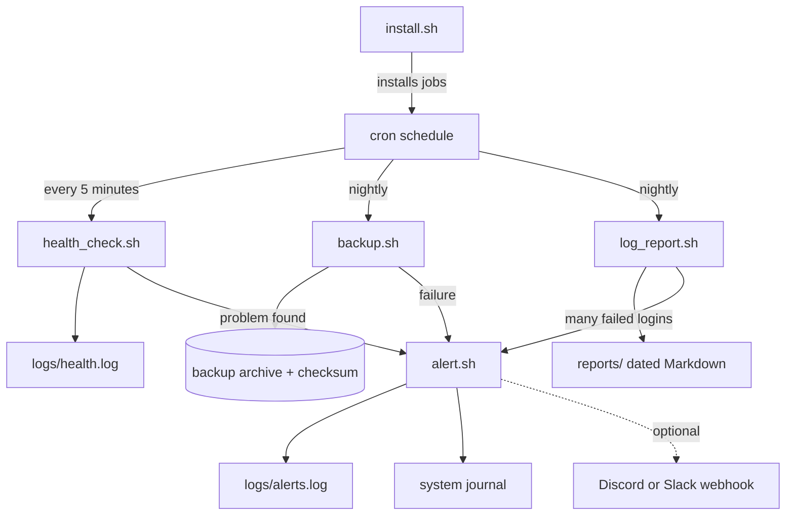

## Quick start

```bash
git clone git@github.com:sivaprakash2k3/linux-ops-toolkit.git
cd linux-ops-toolkit

./install.sh install --dry-run   # preview the cron jobs
./install.sh install             # create folders and install the cron jobs
./install.sh status              # show jobs and latest activity
./tests/run_tests.sh             # run the test suite
```

Requirements: Ubuntu or Debian with `bash`, `cron`, `systemd`, `tar`, `flock` and `sha256sum` (all standard). `curl` is only needed for webhook alerts, and `nginx` for the web part of the log report.

## Usage

```bash
scripts/health_check.sh          # print the health report (add -q for cron)
scripts/backup.sh run            # create a backup
scripts/backup.sh list           # list backups
scripts/backup.sh verify         # check checksum and archive of the newest backup
scripts/backup.sh restore-test   # extract it to a temp folder and compare with the sources
scripts/log_report.sh            # print and save the log report (add -q for cron)
scripts/alert.sh KEY "message"   # record an alert (with cooldown)
```

## Configuration

All settings live in `config/toolkit.conf`. Private values go in `config/toolkit.local.conf`, which is ignored by Git.

| Setting | Default | Meaning |
|---|---|---|
| `CPU_WARN`, `MEM_WARN`, `DISK_WARN` | 80 | Warning thresholds in percent |
| `SERVICES` | `ssh cron nginx` | Services that must be running |
| `ALERT_COOLDOWN_MIN` | 30 | Minutes before the same alert repeats |
| `BACKUP_SOURCES`, `BACKUP_DIR` | demo data, `~/toolkit-backups` | What to back up, and where to store it |
| `BACKUP_RETENTION_DAYS` | 7 | Backups older than this are deleted |
| `FAILED_LOGIN_ALERT` | 20 | Failed SSH logins from one IP that trigger an alert |
| `ALERT_WEBHOOK_URL` | unset | Optional webhook (set it in the local config only) |

## Troubleshooting write-ups

Five failures reproduced on the lab VM and written up with symptom, investigation, root cause, fix and prevention. See [docs/troubleshooting.md](docs/troubleshooting.md) for the index and a troubleshooting routine.

| # | Incident | Main tools |
|---|---|---|
| 1 | [Disk full, and a deleted file that keeps its space](docs/incidents/01-disk-full.md) | df, du, find, lsof |
| 2 | [High CPU](docs/incidents/02-high-cpu.md) | top, ps, kill, renice |
| 3 | [Service down after a bad config](docs/incidents/03-service-down.md) | systemctl, journalctl, nginx -t |
| 4 | [Cron job failing silently](docs/incidents/04-cron-job-silent-failure.md) | crontab, ls -l, chmod |
| 5 | [SSH blocked by the firewall](docs/incidents/05-ssh-blocked-by-firewall.md) | ufw, ss, Test-NetConnection |

More documentation: [backups](docs/backup.md) and [log report](docs/log-report.md).

## Quality and workflow

- Every script is checked with ShellCheck, and the test suite runs on every push and pull request through GitHub Actions.
- Each feature was built on its own branch and merged through a pull request.
- Failures are visible: scripts use exit codes, log to files, and cron output is redirected to `logs/cron.log`.

## Screenshots

| | |
|---|---|
| 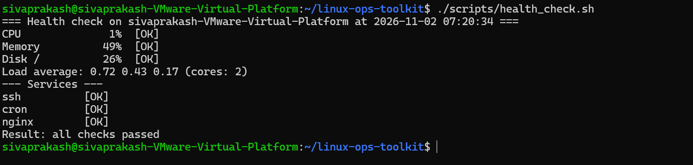 | 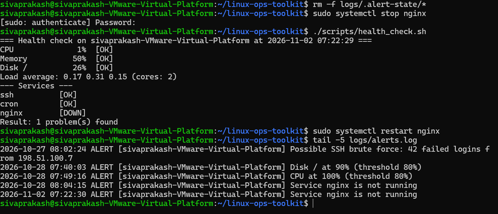 |
| 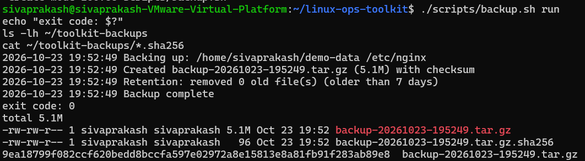 | 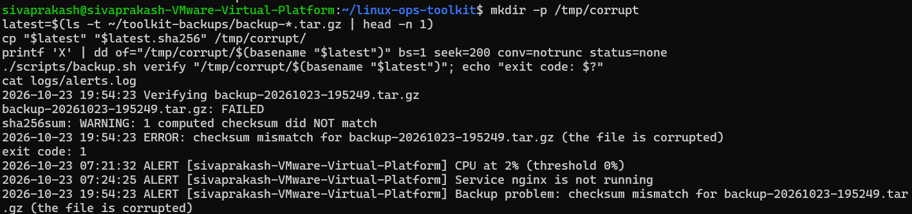 |
| 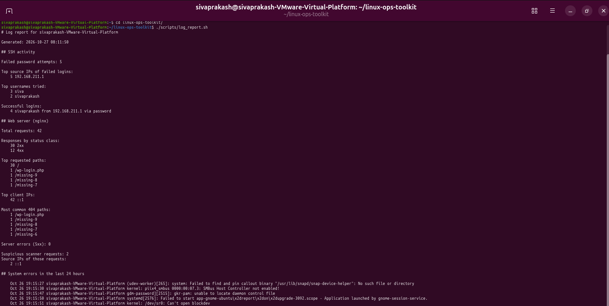 | 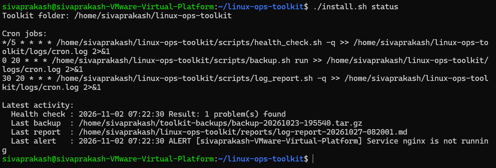 |
| 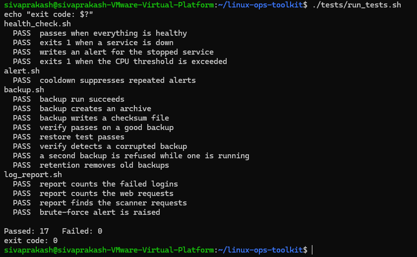 | 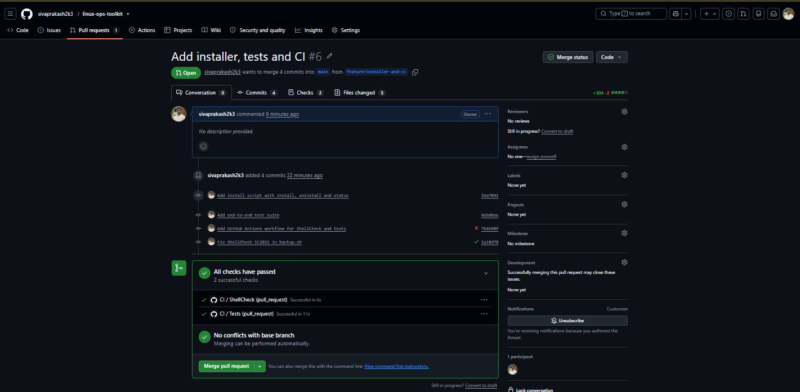 |
| 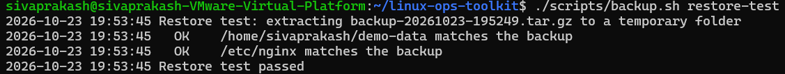 | 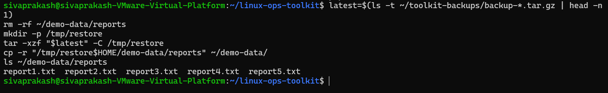 |

## What I learned

- Writing Bash that fails safely: strict variable handling, exit codes, quoting, and ShellCheck-clean code.
- Making automation trustworthy with a lock file, checksums, retention, a restore test and alert cooldowns.
- Cron jobs can fail silently, so their output has to be captured and checked.
- Testing shell scripts with fake commands and temporary folders so tests are safe and repeatable.
- Diagnosing problems layer by layer: disk, CPU, service, permissions and firewall.
- A professional Git workflow: branches, pull requests and checks that must pass before merging.

## License

MIT
